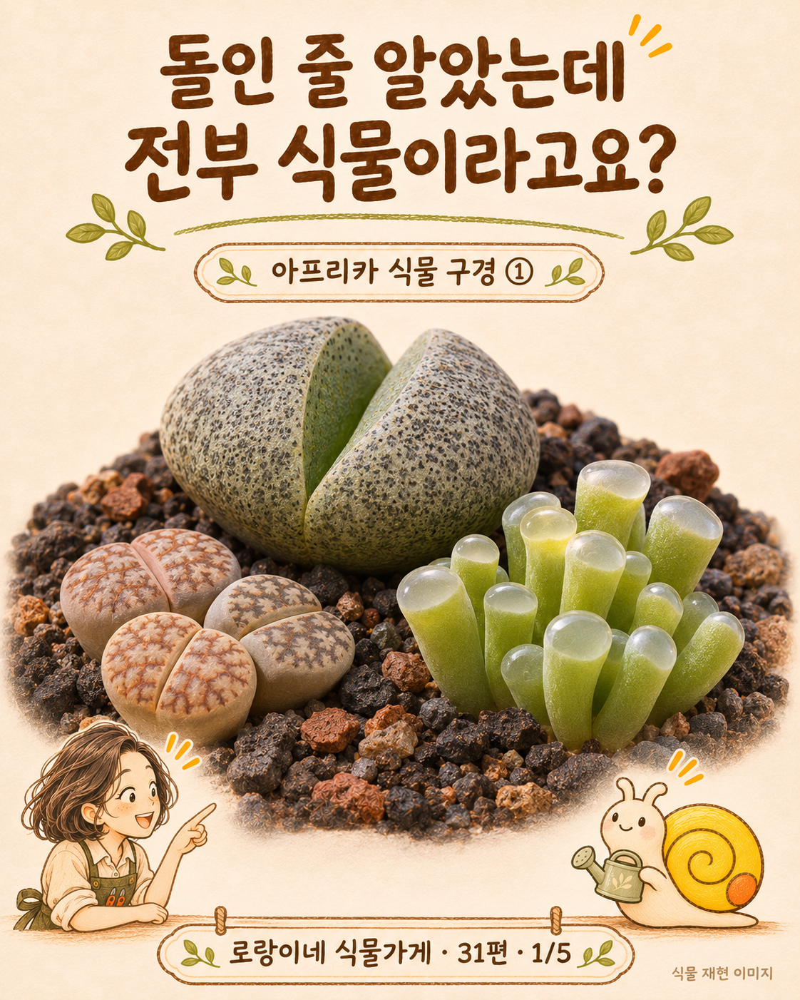
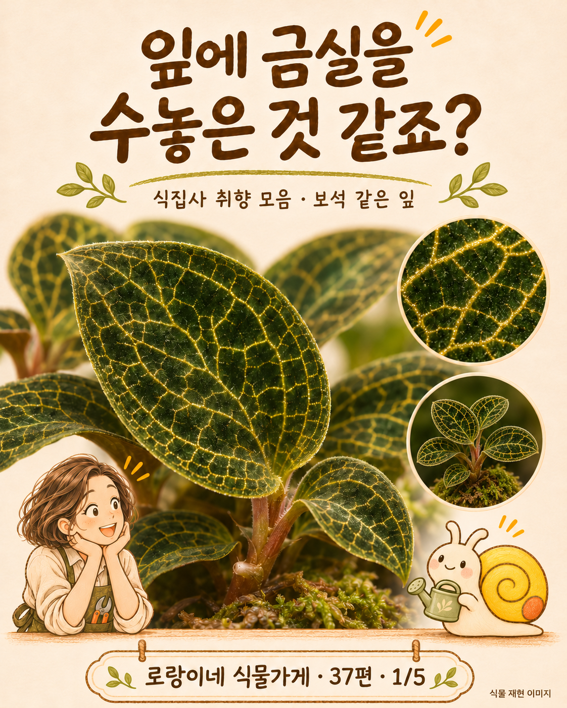

# 로랑이네 식물가게 · 완성 40편 / 50편까지 기획

브랜드: **로랑 드 플랜트** / 캐릭터: **로랑이·랑랑이**

기존 30편에 **완성 10편**을 추가했습니다. 신규 31~50편의 **기획·원고는 20편 모두 작성**했고, 나머지 10편은 이미지 생성 한도로 제작 중입니다. [정확한 제작 현황](31에서50편_제작현황.md)을 확인하세요.

완성본 전체는 **카드뉴스 200장·빠른 무음 릴스 40개**입니다. 제작 중 이미지는 완성 수량에 포함하지 않았습니다.

## 새 시리즈의 방향

아프리카 식물 여행, 투명한 잎과 보석란, 독특한 생태, 수집 취향과 별난 꽃을 다룹니다. 식물 확대컷은 **AI 재현 이미지**입니다. [이미지와 자료 범위](31에서50편_이미지와_자료_안내.md)를 함께 보세요.

 

## 다운로드 방법

원하는 ZIP을 열고 오른쪽 **Download raw file(다운로드 아이콘)**을 누르세요. 전체 브랜치는 **Code → Download ZIP**으로 받을 수 있습니다. 폴더·제작물 이름은 한글입니다.

## 신규 완성 10편

| 편 | 주제 | 다운로드 |
|---|---|---|
| 31 | 아프리카에는 돌인 척하는 식물이 있어요 | [완성본](카드뉴스와_릴스_31에서50편/31편_아프리카_돌을_닮은_식물들.zip) |
| 32 | 거북이 등껍질에서 덩굴이 자라요 | [완성본](카드뉴스와_릴스_31에서50편/32편_아프리카_거북등_괴근식물.zip) |
| 33 | 평생 잎 두 장으로 산다고요? | [완성본](카드뉴스와_릴스_31에서50편/33편_나미브_사막의_웰위치아.zip) |
| 34 | 이 나무는 왜 배가 볼록할까요? | [완성본](카드뉴스와_릴스_31에서50편/34편_아프리카_바오바브의_몸통.zip) |
| 35 | 부채처럼 자라는 나무, 야자수가 아니에요 | [완성본](카드뉴스와_릴스_31에서50편/35편_마다가스카르_여행자나무.zip) |
| 36 | 잎 안이 비치는 식물 세 가지 | [완성본](카드뉴스와_릴스_31에서50편/36편_투명한_창을_가진_다육식물.zip) |
| 37 | 잎에 금실을 수놓은 난초가 있어요 | [완성본](카드뉴스와_릴스_31에서50편/37편_보석란의_반짝이는_잎맥.zip) |
| 38 | 파란 식물 사진, 전부 보정일까요? | [완성본](카드뉴스와_릴스_31에서50편/38편_푸른빛_셀라기넬라의_구조색.zip) |
| 40 | 희귀식물이 유리병 안에서 자란다고요? | [완성본](카드뉴스와_릴스_31에서50편/40편_식물_조직배양_이야기.zip) |
| 41 | 희귀식물 결제 전, 이 사진부터 보세요 | [완성본](카드뉴스와_릴스_31에서50편/41편_희귀식물_구매_전_확인.zip) |

## 신규 제작 중 10편 · 원고 작성 완료

이미지·영상이 완성된 게시용 파일과 구분하세요. 39편은 이미지 수정이 필요하고, 42~50편은 일부 또는 전체 이미지가 아직 없습니다.

| 편 | 주제 | 다운로드 |
|---|---|---|
| 39 | 무늬식물은 전부 같은 원리일까요? | [제작 중 자료](제작중_남은10편/39편_식집사의_무늬식물_취향_제작중.zip) |
| 42 | 오늘 밤 피면 내일은 못 볼 수도 있어요 | [제작 중 자료](제작중_남은10편/42편_밤에_피는_월하미인_제작중.zip) |
| 43 | 밀랍으로 만든 것 같은 호야 꽃 | [제작 중 자료](제작중_남은10편/43편_호야의_밀랍_같은_별꽃_제작중.zip) |
| 44 | 개미에게 집을 내주는 식물 | [제작 중 자료](제작중_남은10편/44편_개미식물의_속_빈_괴경_제작중.zip) |
| 45 | 이거 선인장인 줄 알았죠? | [제작 중 자료](제작중_남은10편/45편_선인장과_닮은_유포르비아_제작중.zip) |
| 46 | 이 꽃은 곤충을 가뒀다가 풀어준대요 | [제작 중 자료](제작중_남은10편/46편_낙하산꽃의_수분_이야기_제작중.zip) |
| 47 | 주머니 식충식물, 전부 같은 식물일까요? | [제작 중 자료](제작중_남은10편/47편_세_대륙의_주머니_식충식물_제작중.zip) |
| 48 | 잎 뒷면 갈색 점, 벌레알일까요? | [제작 중 자료](제작중_남은10편/48편_박쥐란의_잎_뒷면_포자낭군_제작중.zip) |
| 49 | 바닐라가 나무에서 나는 줄 알았죠? | [제작 중 자료](제작중_남은10편/49편_바닐라는_덩굴성_난초_제작중.zip) |
| 50 | 세계에서 가장 큰 꽃, 하나로 답하면 틀릴 수 있어요 | [제작 중 자료](제작중_남은10편/50편_거대한_꽃과_꽃차례_비교_제작중.zip) |

## 기존 11~30편

| 편 | 주제 | 다운로드 |
|---|---|---|
| 11 | 매주 일요일마다 물 주나요? | [완성본](카드뉴스와_릴스_11에서30편/11편_달력보다_흙_상태.zip) |
| 12 | 얼음물로 시원하게 해준다고요? | [완성본](카드뉴스와_릴스_11에서30편/12편_물_온도_확인.zip) |
| 13 | 겨울에도 여름처럼 물 주나요? | [완성본](카드뉴스와_릴스_11에서30편/13편_겨울철_물주기.zip) |
| 14 | 히터 옆이면 식물도 따뜻하겠죠? | [완성본](카드뉴스와_릴스_11에서30편/14편_난방기와_식물_거리.zip) |
| 15 | 에어컨 바람, 식물도 시원하겠죠? | [완성본](카드뉴스와_릴스_11에서30편/15편_에어컨_직접_바람.zip) |
| 16 | 시든 식물에 비료부터 줬나요? | [완성본](카드뉴스와_릴스_11에서30편/16편_비료보다_원인_확인.zip) |
| 17 | 비료, 진하게 주면 더 잘 클까요? | [완성본](카드뉴스와_릴스_11에서30편/17편_비료_농도와_희석.zip) |
| 18 | 뿌리 하나 나왔다고 바로 분갈이? | [완성본](카드뉴스와_릴스_11에서30편/18편_분갈이_필요성_판단.zip) |
| 19 | 새잎이 안 펴진다고 잡아당겼나요? | [완성본](카드뉴스와_릴스_11에서30편/19편_새잎_억지로_펴지_않기.zip) |
| 20 | 잎 끝이 갈색이면 물 부족일까요? | [완성본](카드뉴스와_릴스_11에서30편/20편_갈색_잎끝_원인.zip) |
| 21 | 다육이가 길쭉해졌는데 잘 큰 걸까요? | [완성본](카드뉴스와_릴스_11에서30편/21편_다육식물_웃자람.zip) |
| 22 | 다육이는 물 안 줘도 산다고요? | [완성본](카드뉴스와_릴스_11에서30편/22편_다육식물_물주기.zip) |
| 23 | 수경재배 물은 줄면 채우기만 하나요? | [완성본](카드뉴스와_릴스_11에서30편/23편_수경재배_물_관리.zip) |
| 24 | 잎 한 장 꽂으면 다 뿌리날까요? | [완성본](카드뉴스와_릴스_11에서30편/24편_삽목과_줄기_마디.zip) |
| 25 | 몬스테라가 자꾸 옆으로 누워요? | [완성본](카드뉴스와_릴스_11에서30편/25편_몬스테라_지지대.zip) |
| 26 | 잎이 말리면 무조건 목마른 걸까요? | [완성본](카드뉴스와_릴스_11에서30편/26편_말리는_잎_원인.zip) |
| 27 | 화분을 매일 돌려주고 있나요? | [완성본](카드뉴스와_릴스_11에서30편/27편_한쪽으로_자라는_식물.zip) |
| 28 | 휴가 전 물 두 배로 주면 될까요? | [완성본](카드뉴스와_릴스_11에서30편/28편_휴가_동안_식물_관리.zip) |
| 29 | 고양이 있는 집에 아무 식물이나? | [완성본](카드뉴스와_릴스_11에서30편/29편_반려동물과_식물_선택.zip) |
| 30 | 식물 선물, 예쁘기만 하면 될까요? | [완성본](카드뉴스와_릴스_11에서30편/30편_오래_함께할_식물_선물.zip) |

## 기존 1~10편

| 편 | 주제 | 다운로드 |
|---|---|---|
| 1 | 새잎과 물주기 | [완성본](카드뉴스와_릴스_10편/01편_새잎과_물주기.zip) |
| 2 | 노란 잎의 원인 | [완성본](카드뉴스와_릴스_10편/02편_노란_잎의_원인.zip) |
| 3 | 분무와 물주기의 차이 | [완성본](카드뉴스와_릴스_10편/03편_분무와_물주기의_차이.zip) |
| 4 | 그늘 식물도 빛이 필요해요 | [완성본](카드뉴스와_릴스_10편/04편_그늘_식물도_빛이_필요해요.zip) |
| 5 | 햇빛에 천천히 적응하기 | [완성본](카드뉴스와_릴스_10편/05편_햇빛에_천천히_적응하기.zip) |
| 6 | 분갈이 후 시드는 이유 | [완성본](카드뉴스와_릴스_10편/06편_분갈이_후_시드는_이유.zip) |
| 7 | 알맞은 화분 크기 | [완성본](카드뉴스와_릴스_10편/07편_알맞은_화분_크기.zip) |
| 8 | 배수구 없는 화분 사용법 | [완성본](카드뉴스와_릴스_10편/08편_배수구_없는_화분_사용법.zip) |
| 9 | 잎에 쌓인 먼지 청소 | [완성본](카드뉴스와_릴스_10편/09편_잎에_쌓인_먼지_청소.zip) |
| 10 | 새 식물 해충 점검 | [완성본](카드뉴스와_릴스_10편/10편_새_식물_해충_점검.zip) |

## 구성·원고 자료

- [현재까지 전체 기록 MD](로랑이네_식물가게_현재까지_전체기록_2026년11월04일.md)

완성 편당 카드 5장, 약 9.3초 1080×1920 무음 릴스, 인스타 게시글, 같은 이미지를 쓰는 블로그 상세 본문을 제공합니다.

- [31~50편 원고 전체](31에서50편_원고전체.md)
- [31~50편 제작 기획](31에서50편_제작기획.json)
- [11~30편 원고 전체](11에서30편_원고전체.md)
- [기획·캐릭터·운영 기준](기획과_캐릭터_전체정리.md)
- [프로필·인스타 운영 이미지](프로필과_인스타그램_운영이미지.zip)
